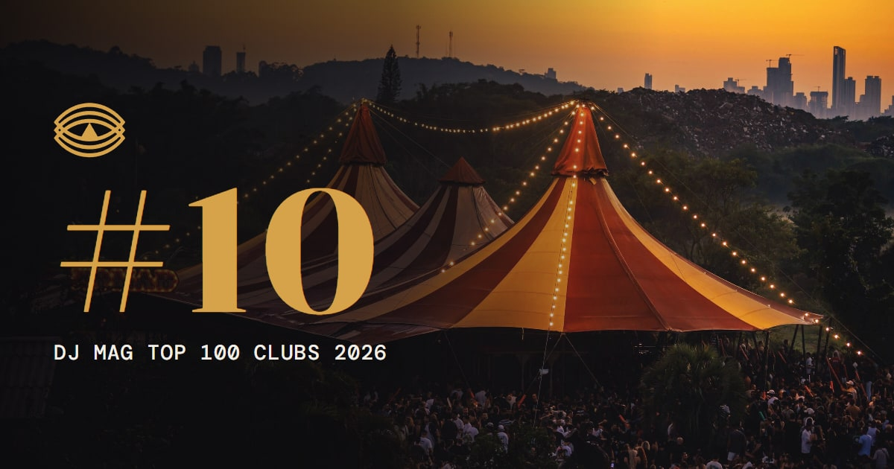

# Surreal Park

Site institucional desenvolvido pela **Fonte Dev** como projeto autoral/demonstração para o Surreal Park (Camboriú/SC) — parque temático com shows, galeria de arte e esculturas.



## Destaques

- **Abertura cinematográfica** — sequência de entrada com profundidade e transições conduzidas por scroll.
- **Rinoceronte 3D vetorizado** — a estátua real do parque recriada digitalmente para a galeria de esculturas.
- **Jardim de esculturas em tour imersivo** — navegação com camadas de profundidade (parallax) pelas peças do parque.
- **Hero com avião suspenso** — elemento assinatura da home, com interações de hover sob medida.
- **Agenda de eventos dinâmica** — cards de artistas, datas e destaques da programação.
- **Loja e galeria** com grade responsiva e lightbox próprios.
- **Performance real**: Lighthouse mobile 100 em acessibilidade, SEO e boas práticas (medido em auditoria interna).
- **LGPD nativa**: página de privacidade e banner de cookies integrados ao projeto, não plugados por terceiros.
- **Mobile-first de verdade**: do celular de entrada ao 4K, com `prefers-reduced-motion` respeitado.

## Stack (visão geral)

Astro 7 (site estático) · TypeScript estrito · CSS próprio com design tokens · GSAP · Lenis (scroll) · elementos 3D vetorizados para as peças do parque.

> O projeto também tem um painel administrativo completo (eventos, galeria, loja, cupons, integrações, LGPD) desenvolvido à parte. Arquitetura, contratos de API e banco de dados ficam em repositório privado — é propriedade da Fonte Dev e não faz parte desta demonstração pública.

## Rodar localmente (site)

```bash
npm install
npm run dev      # http://localhost:4321
npm run build    # gera dist/
npm run check    # typecheck
```

Requer Node 22+. Variáveis em `.env.example`.

## Licença

Código disponibilizado para fins de portfólio e avaliação técnica. **Não é um projeto open source**: uso, cópia, redistribuição ou reaproveitamento comercial não são autorizados sem permissão expressa da Fonte Dev.

---

Desenvolvido por [Fonte Dev · Bruno Lucas](https://fontedev.com) — sites e sistemas sob medida, com direção visual própria para cada cliente.
